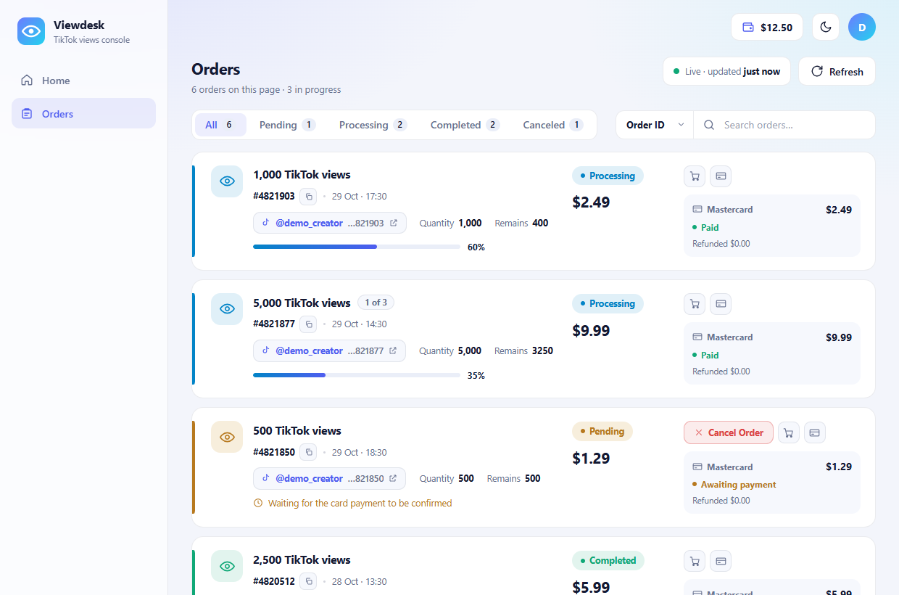
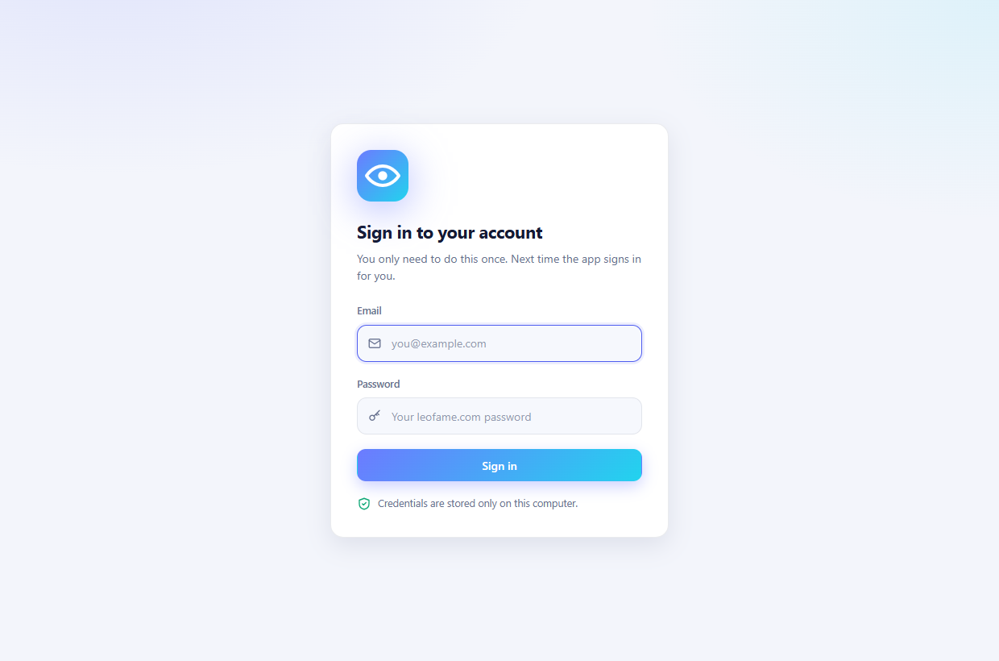
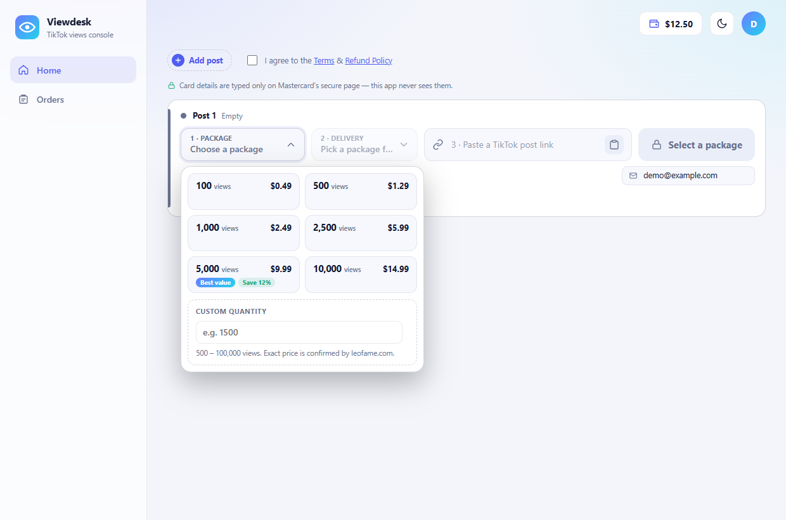
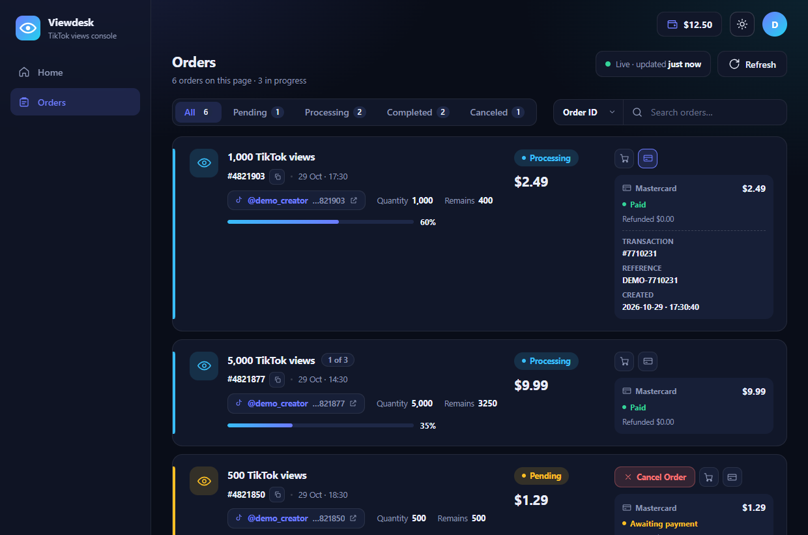
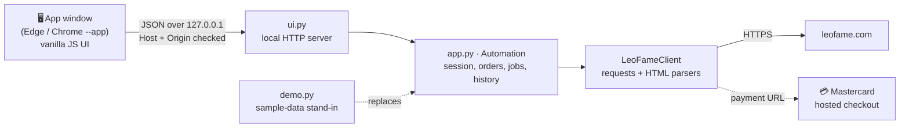

<h1 align="center">Viewdesk</h1>

<p align="center">
  <b>A local desktop console for ordering and tracking TikTok views — built by reverse-engineering a website's own HTTP flows.</b><br>
  Python backend · a single-file vanilla JavaScript UI · no framework, no build step
</p>

<p align="center">
  
  
  
  
  
</p>

<p align="center">
  
</p>

---

## 💡 What is Viewdesk?

[leofame.com](https://leofame.com) is a web shop that sells TikTok views; everything it offers lives in its web pages.

**Viewdesk is a small desktop app that sits in front of that website.** It signs in for you, keeps your orders
in sync in the background, lets you place and cancel orders from one clean screen, and hands the card payment over to
Mastercard's own hosted page. Under the hood it does what the site's pages do — the same requests, the same tokens —
so the project is mostly an exercise in **understanding an undocumented web app and wrapping it in a purpose-built interface**.

> This repository is an **unofficial** hobby / portfolio project. See the [disclaimer](#️-disclaimer) at the end.

---

## 📸 Screenshots

<table>
  <tr>
    <td width="50%"></td>
    <td width="50%"></td>
  </tr>
  <tr>
    <td align="center"><sub><b>Sign in once</b> — afterwards the app signs in for you</sub></td>
    <td align="center"><sub><b>Order flow</b> — packages, delivery speed, custom quantity with exact price</sub></td>
  </tr>
  <tr>
    <td colspan="2"></td>
  </tr>
  <tr>
    <td colspan="2" align="center"><sub><b>Orders</b> — live status, progress, cancel button for unpaid orders, and a payment drawer (dark theme)</sub></td>
  </tr>
</table>

<sub>The screenshots show the built-in demo mode (`python demo.py`): every order, price and payment in them is made up.</sub>

---

## ✨ Features

| | |
| --- | --- |
| 🔐 **Automatic sign-in** | Sign in once; the app restores the saved session or signs in again by itself whenever the site logs you out. |
| 📋 **Live order dashboard** | Orders refresh in the background. Status tabs with counts, search by order ID or post link, progress bars, and a highlight plus toast when an order changes. |
| 🛒 **Guided ordering** | Choose a package or a custom quantity (exact price is quoted by the site), pick a delivery speed, verify the TikTok post, and choose which posts of the account receive the views. |
| 💳 **Safe checkout hand-off** | The order is created, then you pay on **Mastercard's hosted page**. Card details never touch this app; it only checks the payment result afterwards. |
| ↩️ **Cancel & refund** | The same actions the site offers — including *Cancel all unpaid* — with the payment record (method, amount, status, refunds) one click away. |
| 🌗 **Light & dark theme** | Responsive layout, keyboard-friendly controls. |

---

## 🧠 Engineering highlights

- **Reverse-engineered, not scraped blindly.** The request flow was captured, studied, and re-implemented to mirror what the site's own JavaScript
  does (CSRF-style tokens, the post-check step, the "choose posts" handshake, the payment redirect). The raw network captures are deliberately
  not published — such files contain session data.
- **A tolerant HTML parser.** Orders and payments come from server-rendered tables. A hand-written `html.parser` state machine turns them
  into structured data by looking up columns **by header name**, not position — and falls back to a plain-text table if the layout ever changes.
- **A tiny local server, locked down.** The UI is served from `127.0.0.1` on a random port. Every request is checked against its `Host` and `Origin`
  header, which blocks other websites and DNS-rebinding tricks from talking to it. The app window sends a heartbeat; when the window closes the server shuts itself down.
- **Zero-framework UI.** One HTML page with its own CSS and JavaScript (≈2,300 lines): order cards are updated by key so a background sync never
  flickers or steals your text selection, and keyboard focus is restored after an update.
- **Small and honest dependency footprint.** Python standard library plus `requests`.
- **A safe demo mode.** `demo.py` runs the *real* UI against built-in sample data so it can be explored without an account — payments are disabled there.

---

## 🏗️ Architecture



| File | Role |
| --- | --- |
| [`app.py`](app.py) | The automation core: HTTP client, HTML parsers for orders and payments, order / payment / cancel logic, saved state |
| [`ui.py`](ui.py) | The local web server and the whole UI (HTML + CSS + JS in one file) |
| [`run.py`](run.py) | Starts the automation and the UI together |
| [`demo.py`](demo.py) | Runs the real UI on sample data — no account, no network |

---

## 🚀 Run it

```bash
git clone https://github.com/shizan52/Viewdesk.git
cd Viewdesk
pip install -r requirements.txt
```

**Try the demo (no account needed, nothing can be bought):**

```bash
python demo.py                 # opens the app window
python demo.py --no-window     # or open the printed address in any browser
python demo.py --signed-out    # start at the sign-in screen
```

**Use it for real** (needs your own leofame.com account):

```bash
python run.py
```

Settings, the saved session and the order history are stored in `%APPDATA%\Viewdesk` — outside the project folder.
The app window uses Microsoft Edge or Google Chrome when installed; elsewhere use `--no-window` and open the printed address.

---

## 📝 Notes & limitations

- For automatic sign-in the e-mail and password are stored **in plain text** in `config.json` inside your own user profile (never in this
  repository). Treat that machine accordingly. Card details are never stored: payment happens on Mastercard's page.
- It depends on the structure of a third-party website, so a redesign on their side can break parts of it. That is the nature of this kind of tool.
- Windows is the primary target (window launcher, `%APPDATA%`); the server and UI themselves are plain Python and a browser.

---

## ⚠️ Disclaimer

Viewdesk is an **unofficial**, independent project for learning and portfolio purposes. It is **not affiliated with, endorsed by, or
connected to** leofame.com, TikTok, ByteDance, or Mastercard; all names and trademarks belong to their owners. Buying engagement from third
parties can conflict with the terms of the platforms involved, and using any service is at your own risk and responsibility. Use it only with
accounts you own and in line with the terms of the sites you use.

---

## 👤 Author

**Tayb Hassan Shizan** — [github.com/shizan52](https://github.com/shizan52)

<p align="center"><sub>© 2026 Tayb Hassan Shizan. All rights reserved. The source is shared for portfolio and review purposes.</sub></p>
